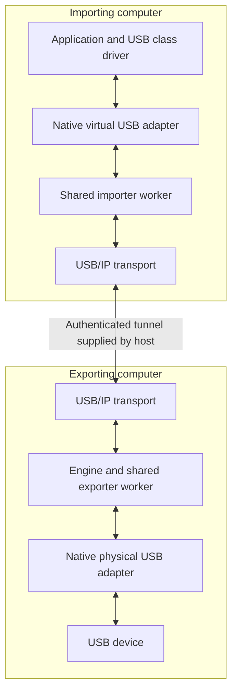
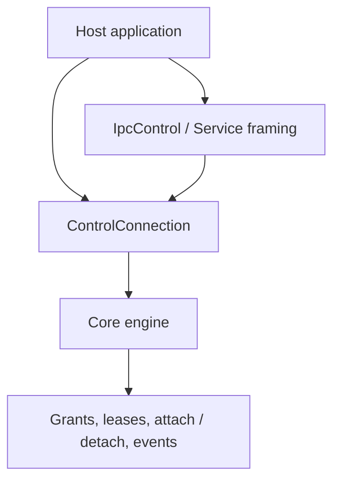

# Architecture

KnightBus carries USB requests between a virtual device on the importing computer
and a physical device on the exporting computer. Applications use their normal
USB drivers; KnightBus translates between native USB operations and USB/IP.

## Data flow

Connection setup discovers the remote device, validates its descriptors and
capabilities, and publishes it through the importer's native USB stack. The
exporter checks access and acquires the physical device before confirming import.

For each transfer, the importer reads a native request and assigns its USB/IP
sequence. The exporter submits it to the physical device and returns the result.
The importer matches that result to the original native request and completes it.
Cancellation follows the same ownership rules as completion.

## Code map

Paths below are relative to the repository root. Crates live under `crates/`.

| Component | Owns |
| --- | --- |
| [`knightbus-usb`](../crates/knightbus-usb/src/lib.rs) | USB constants, setup packets and allocation-free descriptor validation; usable without the Rust standard library |
| [`knightbus-usbip`](../crates/knightbus-usbip/src/lib.rs) | USB/IP wire encoding, decoding and validation, with explicit allocation admission |
| [`knightbus-core`](../crates/knightbus-core/src/lib.rs) | Access policy, sessions, memory/request budgets, descriptor inventory and device workers |
| [`knightbus-transport`](../crates/knightbus-transport/src/lib.rs) | TCP framing, discovery, forwarding, deadlines, backpressure and socket readiness |
| [`knightbus-ipc`](../crates/knightbus-ipc/src/lib.rs) | Framed management requests over the core control contract |
| [`exporters/knightbus-macos-exporter`](../crates/exporters/knightbus-macos-exporter/src/lib.rs) | IOUSBHost discovery, capture, transfers and native callbacks |
| [`importers/knightbus-windows-importer`](../crates/importers/knightbus-windows-importer/src/lib.rs) | Virtual controller ownership, driver channel encoding and Windows notifications |
| [`knightbus-windows-protocol`](../crates/knightbus-windows-protocol/src/lib.rs) | Allocation-free messages and validation shared by the Windows importer and kernel driver |
| [`drivers/windows`](../drivers/windows/src/lib.rs) | UdeCx virtual USB controller, native requests and kernel resource ownership |

The core has no sockets or OS USB bindings. The transport uses the core and wire
codec. Native adapters implement core traits; the shared crates do not depend on
an OS adapter. The Windows kernel driver builds separately because it needs the
WDK and a different Rust toolchain and build profile.

## Shared workers and native ownership

The core's exporter worker preserves endpoint order, serializes configuration
changes, and tracks cancellation and retirement. Its importer worker correlates
native tokens with wire requests, manages endpoint credits, and tracks selected
interface settings. The transport drives these workers and forwards messages.

Native adapters own handles, OS buffers and callbacks. They report capabilities
before device publication and implement required notifications. Normal transfer
work wakes on events; deadlines and failed cleanup can still require timed checks.

Memory and request credits are reserved before allocation or submission and stay
with their owners. Bounded queues push back on producers. A cancellation request
or timeout does not prove that an OS callback has stopped: storage remains alive
until native retirement is confirmed. Failed cleanup retains affected resources
instead of freeing memory the OS may still access.

## Native adapters

On macOS, the exporter uses IOUSBHost to access the physical device. On Windows,
the importer communicates with the KnightBus UdeCx driver, which presents a virtual
device to Windows USB class drivers. The driver validates its private channel
independently using `knightbus-windows-protocol`; it does not parse USB/IP traffic.

The importer accepts one selected configuration. Bulk and interrupt endpoints
keep one outstanding request each; ISO endpoints can queue several requests within
the same device-wide memory limit. Windows limits descriptor trees to 4 KiB and
transfers to 1 MiB, and does not support remote wake or bulk streams.

ISO packets keep their individual lengths and errors across USB/IP. The exporter
queues physical transfers ASAP. Windows uses a local virtual frame clock and holds
early replies until their scheduled frames finish; the two hosts do not share a
USB clock. These timing buffers apply only to ISO transfers.

Core also owns configuration changes, alternate-setting changes and halt recovery.
It validates each target and drains only the affected requests. Native adapters
implement explicit device/interface operations; each interface owns its own pipe
handles, so unrelated interfaces can keep their outstanding transfers.

To add an adapter, implement the core's native driver trait and reuse the workers
and transport. See [Contributing](../CONTRIBUTING.md#adding-an-os-adapter).

## Management path

Management operations use the same engine whether called directly or through
framing. USB payloads stay on the data path. `knightbus-ipc` supplies framing and
dispatch, not a daemon, OS-authenticated socket or C ABI. The host supplies verified
caller identity and the authenticated peer connection.
