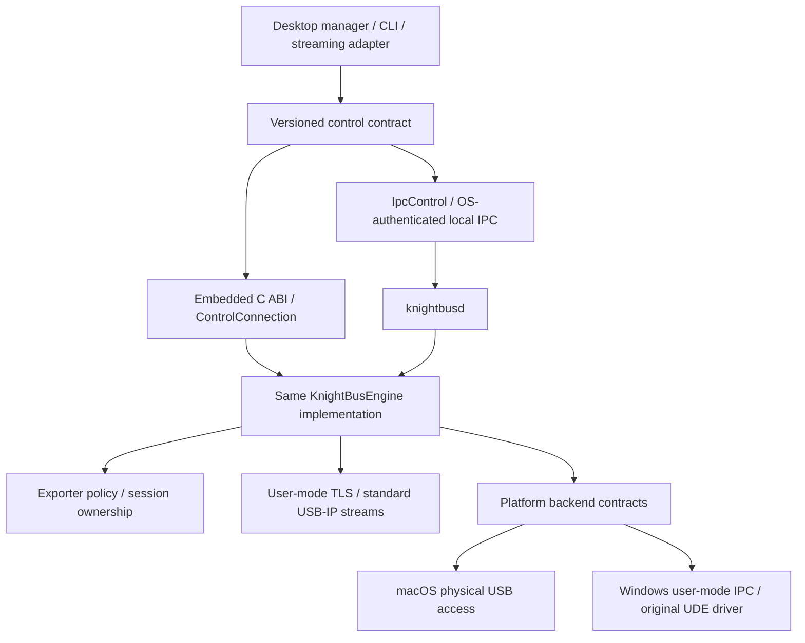

# KnightBus architecture

The workspace implements the portable engine, [USB/IP codec](protocol-usbip-1.1.1.md),
bounded TCP transport, macOS exporter and Windows importer. The Windows kernel
driver is built separately. Embedded and framed control adapters share the same
engine and connection ownership rules. Authenticated transport integration and
production host deployment remain separate work; the standalone programs require
an authenticated tunnel supplied by their host.
See the [measured gates](gate-status.md) for supported scope and remaining tests.

## One engine and its hosts

Both modes are mandatory. Service is the initial default for the macOS and
Windows targets because it separates privileges, application lifetime and driver
installation from GUI/streaming processes. Embedded hosts the same engine where
OS permissions permit, without elevating the whole host to bypass a missing
backend privilege path. Neither mode changes USB/IP framing or removes native
USB/driver requirements. See [dual-mode hosting](decisions/dual-mode-hosting.md).

## Package boundaries

The current implementation has these boundaries:

| Crate | Responsibility |
| --- | --- |
| `knightbus-usbip` | Wire validation, flags, status codes and encoding with explicit allocation admission; no OS code |
| `knightbus-usb` | USB constants, setup packets and allocation-free `no_std` descriptor structure and topology |
| `knightbus-core` | Policy, sessions, admission, descriptor inventory, native worker scheduling and retirement |
| `knightbus-transport` | Bounded TCP framing, exporter serving, importer bootstrap/forwarding and event waits |
| `knightbus-windows-protocol` | `no_std` Windows channel validation and native descriptor restrictions, using `knightbus-usb` |
| `knightbus-ipc` | Framed control host using core’s `ControlConnection`; embedded callers use it directly |
| Platform exporter/importer | OS handles, callbacks, native encoding, device discovery and host entry points |

Codec callers use one `encode` and one `decode` entry point, both with explicit
admission. Borrowed transfer frames avoid temporary payload copies. `Engine::new`
validates its configuration and then gives its budget to a backend factory;
native work therefore uses the same admission owner. `Forwarder` takes its budget
and timeout from its wire connection rather than accepting conflicting copies.
Device-specific qualification commands live in examples and tests.

Native implementations use `core::exporter::Driver` or `core::importer::Driver`
through their shared workers. Required capabilities declare limits before native
publication. The exporter worker owns per-endpoint order, topology barriers,
cancellation and retirement. Its driver reports the OS's selected endpoint and
performs the native request. The importer worker owns sequence/token correlation,
cancellation delivery, selected settings, credits and event-driven scheduling.
Its driver supplies typed requests, native liveness and retirement operations.

`transport::importer::connect` composes discovery, capability checks, configuration
verification, the native worker and forwarding with one budget. Exporter hosts
compose the shared worker through `Engine::new` and use `transport::exporter::serve`.
Neither OS crate owns a USB/IP forwarding loop. See [implementing an adapter](native-adapters.md)
for required operations, ownership rules, tests and current shared limitations.

Both core backend traits require `set_waker`; there is no polling fallback.
The shared `WakeSource` registers and wakes the host outside its lock, including
on registration so earlier work cannot be missed. Adapters signal lifecycle,
removal, request, cancellation and completion changes after publishing state.
The core has no runtime dependency. The transport uses Mio for OS socket readiness
and wakeups; hosts retain bounded deadline and cleanup checks. Reads return as soon as one frame is complete. Read/write batches remain
bounded, and writable readiness is enabled only after socket backpressure so an
idle connection does not spin. Poller metadata has a separate fixed admission
allowance retained through the last wake owner; OS allocations remain subject to
platform qualification.

The broader host design assigns these responsibilities:

| Proposed component | May depend on | Must not own |
| --- | --- | --- |
| `knightbus-core` | Rust standard library | OS handles, platform FFI, sockets, runtime, USB/IP parser or UI |
| `knightbus-engine` | Core control/capability types | OS-specific APIs, duplicate per-host logic or platform installation |
| `knightbus-ipc` | Core contract | USB requests, TLS peer traffic, privileged USB ownership or fallback engine |
| `knightbus-ffi` | Core and the shared engine | A second session/policy implementation or borrowed foreign buffers retained implicitly |
| `knightbusd` | Shared engine/core | A daemon-only protocol implementation |

These names describe responsibilities rather than a required crate count. M6 uses
`knightbus-core` for contracts, exporter/importer lifecycle and policy, plus
`knightbus-ipc` for framed control. Embedded callers use core’s `ControlConnection`
directly. Both paths dispatch to the same engine; native attachment succeeds only
when the injected backend acknowledges it.
M12 still owns production IPC and foreign ABI stability.

Introduce packages when their implementation arrives. M5 supplies the workspace,
basic CI and `knightbus-usbip`, a pure specification-derived byte codec. M6 adds exporter/
importer orchestration and policy to the engine, splitting crates when complexity
requires it; later transport and platform crates own networking and OS resources.
The Windows kernel driver remains a separate workspace/toolchain/profile because
its WDK, no_std, panic and target rules differ from portable userspace.

The dependency direction is inward: applications/adapters → engine → portable
contracts and codec. Platform/transport implementations satisfy those contracts
and are injected at host composition, never called through OS conditionals in the
codec/core. A new OS backend must not require a USB/IP wire change.

## Control and data paths

The [control contract](control-api.md) owns pairing intent, filtered inventory,
exporter grants, attach/detach, session queries and diagnostics/events. It is the
only interface used by the desktop manager, CLI and future C++ integration.
The engine owns all USB/IP and backend I/O. In Service mode, USB reports/URBs do
not cross application control IPC; daemon/backend networking proceeds directly.
Closing a GUI does not close a device lease unless the selected policy says so.

USB/IP 1.1.1 DEVLIST/IMPORT and transfer/unlink frames remain unmodified. Their
success fields are not authentication. The authenticated peer tunnel supplies
identity and session binding before any standard USB/IP parser is exposed.
A separate versioned peer-control channel handles grants/leases/events. Local
management IPC, peer control and USB/IP data are three distinct trust boundaries.
Production defaults to encrypted authenticated tunnels; explicit stock-peer
interoperability is an isolated mode, never an opportunistic downgrade.

## Exporter authority and sessions

Only an exporter administrator enables sharing and grants an authenticated
importer access. A paired peer alone has no device grant. The engine filters
inventory and events by grant before disclosing device details. Peer keys identify
importers; VID/PID, serials and busid are selectors, never authorization.

Attach authorizes the peer/device/generation, reserves bounded credits and the
exclusive device, claims through the physical backend, rechecks current grant
and generation, and then commits import success. Revoke/removal during acquisition
aborts and compensates owned work. Importers cannot grant themselves access.
Batch attach journals each acquisition and compensates in reverse order; it does
not claim distributed atomicity or disturb unrelated devices on rollback.

A lease binds peer identity, connection generation and exporter monotonic expiry.
Reconnect must establish a new session; old replies/tokens cannot be replayed.
M6's `Engine::new` injects a physical backend, clock, limits and host epoch;
its `Budget` can also be shared with the importer. The host supplies runtime ticks
and authenticated caller identity. Transport and persistent policy/store composition
remain later work; no runtime dependency is selected. A tentative 5-second
heartbeat/20-second lease and 5-second cleanup budget need measurement; they are
not wire constants or production guarantees.

## Transfer and backend ownership

A physical backend claims descriptors/interfaces, submits validated operations,
cancels by backend token and reports terminal callback retirement. A virtual
backend creates from validated remote descriptors, emits native requests,
consumes completions and detaches. Neither sees TLS private keys or raw unbounded
network buffers. Endpoint types come from validated descriptors, not SUBMIT alone.
Capabilities remain per direction/device/context; see [platform matrix](platform-support-matrix.md).

The M6 session owner serializes completion and cancellation. Backend buffers
stay alive until callbacks retire even if a wire response was already committed.
Successful unlink suppresses a later target reply; completion-winning races get
the standard too-late result. Strict generation/sequence accounting rejects
stale/duplicate completion and prevents wrap reuse. The full implementation and
fixtures belong to M5/M6, not this architecture milestone.

Reserve aggregate byte/request credits before allocation/submission, with
independent cancellation/control capacity. Bound descriptor/control sizes, ISO
packet arrays and event queues. Reject unsupported flags and overflow before
allocation. Backpressure reaches physical submissions instead of accumulating
an unbounded reply queue. Numeric production limits will be qualified per backend;
M3's 4 KiB/single-pipe limits were narrow experimental settings.

## Lifecycle, errors and recovery

The intended lifecycle distinguishes creation, active operation, draining and
termination. Review exact states and idempotency in M6. Shutdown freezes ingress,
invalidates sessions, cancels/drains, detaches native devices and restores local
ownership.
A deadline failure quarantines resources and returns a stable cleanup failure;
it does not free memory still referenced by OS callbacks. Drop is not proof of
restoration. Crash recovery reconciles the journal before allowing new claims.

M3 showed why native USB requests must be canceled when a user-mode owner exits:
they belong to class drivers, not to the owner's private control handle. The
repaired spike retired owned requests/objects; UdeCx retained other queues. The
production driver must solve that separate M1 resource issue, without an implicit
controller-recycling or memory-growth exception.

Adapters share stable numeric errors/events. Mode differences affect only caller
authentication and host lifetime. Structured native diagnostics include operation
phase and sanitized status; user-visible errors never expose hidden inventory.
Events use monotonic subscription sequence numbers and explicit resnapshot on
overflow/gap. Callbacks cannot run under engine locks or block I/O workers.

## Delivery boundaries

M4 contains architecture and decisions only. M5 owns workspace/CI and USB/IP;
M6 owns meaningful control parity/state machines; M7–M10 own native backends;
M11 security/pairing; M12 full C/IPC SDK and real-device hosting parity; M13 an
optional standalone desktop manager; M14–M15 streaming integrations. Service and
SDK packages do not silently install drivers or elevate callers. Distribution
requires supported Apple integration, Microsoft signing and measured recovery.
See [decisions](decisions/README.md), [security](security-model.md) and
[testing](testing-strategy.md).
