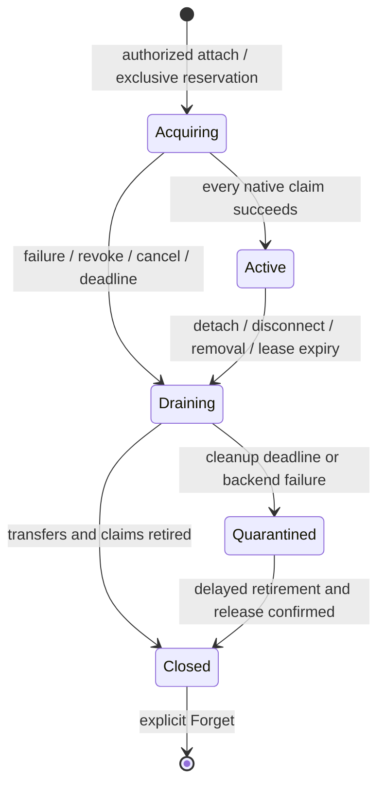
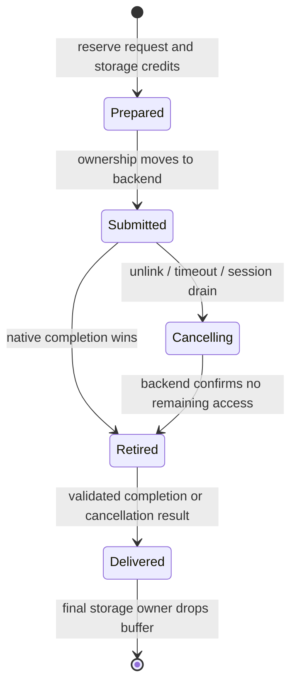

# Milestone 6: portable engine and mock host parity

Implemented on `milestone6`, without platform USB dependencies or new third-party
packages. This milestone proves portable policy/lifecycle behavior with deterministic
backends. It does not change the native feasibility or production release gates.

## Review map

| Code | Responsibility |
| --- | --- |
| `knightbus-core/src/model.rs` | Device topology, identities, generations, errors and session states |
| `resource.rs` / `transfer.rs` | Aggregate admission, owned storage, immutable request identity and retirement |
| `backend.rs` | Nonblocking physical/virtual backend contracts and importer lifecycle |
| `engine.rs` | Exporter policy, leases, concurrent transfers and rollback |
| `control.rs` | Shared versioned management operations and fixed-size events |
| `knightbus-embedded` | Thin `InProcessControl`, with host-bound caller authority |
| `knightbus-ipc` | Bounded Service harness, request/reply framing and `IpcControl` |
| `knightbus-core/tests/engine.rs` | One mock apparatus and shared host contract scenarios |

Exporter, importer and control are implemented as core modules rather than three
extra crates. This follows the M4 decision to split packages when useful; neither
host adapter contains a second policy or transfer engine. USB/IP structures and
encoding remain in `knightbus-usbip`.

## Identities, policy and ownership

The trusted host supplies authenticated peer fingerprints and local administrative
rights. Request arguments cannot grant those rights. Pairing/TLS and OS principal
verification remain M11/M12 work; `Caller` is a trusted composition boundary.

The exporter assigns persisted device IDs, mapped to `kb-` plus 16 hexadecimal
digits in the standard USB/IP bus ID field. Physical generations increase on
replug. A replug clears grants and requires explicit authorization. VID/PID, paths,
bus IDs and requested peer IDs are selectors, not credentials. Hosts must preserve
ID/generation mappings and use a fresh nonzero engine epoch after restart.

Discovery filters wire records and control snapshots. Both fabricated USB/IP
IMPORT selectors and control attach requests repeat authorization. Each attachment
is exclusive; safe multi-import is not advertised. A batch reserves every device,
acquires in order, and rolls back attempted claims in reverse order, including a
failed or still-pending acquisition. This is a local compensating transaction,
not distributed atomicity. IMPORT success is legal only once the lease is Active.

Closed records are bounded and can be explicitly forgotten. On admission pressure,
the engine automatically evicts the oldest closed records, both at the session limit
and when their retained memory prevents a new lease. Draining/quarantined records
are never candidates. Terminal status is best-effort history: evicted IDs return
the same Denied result as other unknown session IDs. Serial IDs never repeat.
Draining/quarantined sessions retain exclusive ownership. Reconnect creates a new
session; old tokens cannot act on it. Heartbeats use the injected monotonic clock;
late renewals cannot revive expired leases. Acquisition is capped by the lease
budget even if the caller requests an unlimited deadline.

The importer separately moves Idle → Attaching → Active → Draining → Idle.
Failed/expired attach also drains. Cleanup expiry enters Quarantined; only native
detach acknowledgement returns to Idle. Transport authorization precedes native
attach. Production native forwarding is left to the backend milestones.

## Transfers, credits and cancellation

Multiple operations can be outstanding. Submission order is preserved per endpoint
at the backend boundary; completions correlate independently and may arrive out of
order. Sequence numbers strictly increase across SUBMIT and UNLINK within a lease;
wrap requires a fresh lease. A batch shares this sequence namespace. One USB/IP
connection normally imports one device.

Endpoint metadata determines transfer type. The engine checks device ownership,
endpoint/direction, supported flags, control setup length/direction, and ISO layout.
Original ISO offsets/lengths cannot be mutated by a backend; result identities and
actual lengths are checked again on retirement. M6 supports alternate setting zero
and the registered active configuration. SET_ADDRESS, SET_CONFIGURATION and
SET_INTERFACE are explicitly rejected until native topology coordination exists.

`Budget` charges bytes before allocation/adoption and native request credits before
preparation/submission. Charges include payload capacity, both ISO descriptor
arrays, transfer metadata, pending records, inventory vector capacity, grants,
retained sessions, prepaid completion slots and event queues. Allocator bookkeeping,
collection-node overhead and Rust stack memory are excluded; this is a storage
admission ledger, not an RSS measurement. Cardinality limits additionally bound
metadata collections. Native/backend-owned resources need their own bounds.

Temporary transport/parser storage can use `Budget::buffer`. `Budget::decoder`
now drives the codec's allocation-admission hooks before allocating frame storage,
ISO arrays, management records or payload copies. Its `DecodedMessage` owner keeps
those charges alive after the decoder is dropped. Converting an OUT SUBMIT moves
its payload into native ownership without releasing/reacquiring its byte credits;
IN receive storage is admitted separately. `Budget::encode` returns charged output
storage. The source message remains charged while encoding.

The hooks are optional, backward-compatible codec APIs with no dependency on core.
Unadmitted `decode`, `encode`, `Decoder::push` and blocking helpers remain suitable
for separately bounded callers, but do not automatically use engine credits.
Admission conservatively retains temporary/reallocation charges until the decoded
owner is dropped or converted; the input receive buffer is a separate charge.
Allocator-reported excess capacity is charged before exposure; a failed extra
reservation drops that allocation. Allocator overhead is excluded.

`SubmitHeader` separates allocation-free wire metadata from payload/ISO owners.
Existing `Submit` literals remain supported; `into_parts` and `with_payload` move
storage without copying. Core transfer constructors now take `SubmitHeader`.
No pools for USB payloads or kernel zero-copy are required.

Cancellation does not release storage or request credits. Request credits return
at native retirement; bytes remain charged through slow completion consumers until
their owners drop. A successful unlink emits its own sequence only after retirement
and suppresses the target submit reply. If normal completion already committed,
unlink reports TooLate. A stalled cancellation quarantines the session.

Completion storage is a single prepaid slot pool with head/tail indices per lease.
Enqueue and dequeue perform constant slot work without shifting another session's
records; draining touches only that lease's queued events. Pending-transfer scans
use session-specific BTreeMap ranges, including cancellation and cleanup. Retired
but unconsumed events occupy
submission slots, including zero-byte/cancellation results. Cleanup traverses
existing records without allocating temporary work lists and does not need data
credits. Backend cancellation must obey the same rule. Backend Drop must retain or
retire any native-accessible storage on unexpected host destruction; freeing a Rust
owner is not proof of native callback retirement.

## Initial host contract

Both adapters use `KnightBusControl` and the same `Engine`. They implement list,
authorize, attach/detach, status, heartbeat, subscriptions, forgetting closed records
and graceful shutdown. Engine mutation is single-owner; hosts drive nonblocking
`tick` calls using their runtime. Events are polled outside engine mutation; no
callback context can outlive unsubscribe. Closing either management adapter retires
its subscriptions while engine-owned leases remain active.

The M6 Service harness serializes requests **and responses** through a strict,
length-prefixed binary schema, with no USB data fields. Frames are at most 8 KiB;
lists are at most 256 entries. IDs remain full-width u64 values. Unknown tags,
invalid booleans/counts, truncation and trailing bytes are rejected. Major version 1
is required. Request IDs strictly increase per connection; an old connection epoch
cannot replay operations. Queued cancellation and deadlines are enforced before
dispatch. A dispatched attachment is canceled through Detach, with normal retirement.
Control requests and slow responses share a bounded connection queue; cancellation
uses the existing slot. Ordinary event subscriptions have a per-peer quota across
connections (default 4), plus a global limit (default 32). One slot and its queue
storage are prepaid for administrators by default; each administrative peer can
use at most one reserved slot in addition to its ordinary quota. These reserved
queues remain usable even if ordinary subscriptions or data memory are exhausted.

Event sequences start at one per subscription and advance only for visible events.
Inventory changes notify administrators and affected grantees, including the peer
whose grant was just revoked. Hidden lifecycle events do not advance another
subscriber's sequence or its Resync marker. Event overflow requires snapshot refresh.

This is the initial deterministic IPC contract harness, **not an OS-authenticated
socket listener, daemon, network transport or C ABI**. M12 must implement bounded
stream framing, OS peer checks, global connection limits and deployment. The earlier
JSON preference remains open for that public SDK; this small fixed-field test schema
avoids introducing JSON dependencies or freezing the production wire format now.
The M6 Rust adapter API and provisional schema are not an ABI stability promise.

## Validation

The reusable suite covers policy denial and forged imports, exclusive ownership,
replug generations, partial acquisition rollback, revoke while acquiring, lease
expiry, importer retirement, all exporter lifecycle states, repeated detach,
shutdown, restart tokens, cancellation/completion races, delayed callbacks,
quarantine, exhausted bytes/request slots, slow consumers, payload pointer reuse,
ISO identity corruption, malformed endpoint/setup/flags, subscription ownership,
event overflow, host drop, IPC versions/access/replay/deadlines and frame parsing.

Shared scenarios run through both adapters against the same deterministic backend
implementation. Additional data-path tests inject native completions and a fake clock;
no physical hardware, sleeps, privilege escalation or third-party USB forwarding
implementation is required. Existing workspace CI automatically covers the new crates.

Executed on 2026-11-11 with Rust 1.85.0:

| Environment | Results |
| --- | --- |
| macOS ARM64 | Formatting; Clippy for all workspace targets with warnings denied; debug and release tests; doctests; documentation with warnings denied |
| Linux x86-64, Debian Bookworm Rust container on Docker Desktop | Offline debug and release workspace tests, doctests, and documentation with warnings denied; container networking disabled |

Each profile passed **25 M6 tests plus 19 existing protocol tests**. The existing
codec doctest also passed. The M5 corpus-writing helper remains intentionally
ignored. No test was skipped because of missing hardware. Linux used an isolated
source copy and the installed `1.85.0-x86_64-unknown-linux-gnu` toolchain explicitly;
the initial container invocation tried to synchronize the project toolchain and was
replaced with that offline invocation. Local log: `/tmp/knightbus-m6-linux-check.log`.

Windows execution and GitHub-hosted jobs were not run during this local change;
the existing Windows/macOS/Linux CI matrix will exercise these workspace tests
when pushed. No native device, sustained webcam throughput or production host-mode
claim follows from these mock tests. No commits or publication were performed.

## Review fixes and scaling validation

The review added six core regressions and two protocol regressions: closed-record
reclamation, quotas across both host adapters and connections, reserved admin memory,
event privacy/overflow, interleaved slot reuse, and admitted wire-to-native ownership
through actual mock completion. The codec tests inject failure at every allocation
stage of all 24 golden frames. Existing fuzz targets also vary allocation admission.

Local release comparison on macOS ARM64, Rust 1.85.0, using identical mock workloads
before and after the review fixes. Seven samples per case; tick samples average 200
ticks after warmup. Setup/submission/completion production is excluded from drain
timing; retrieving and dropping each completion is included. Queue limits are raised
above defaults. These are synthetic engine measurements, not physical USB throughput.

| Workload | Before median | After median |
| --- | ---: | ---: |
| Tick: 64 sessions, 4,096 pending | 417 µs | 28.3 µs |
| Tick: 256 sessions, 4,096 pending | 1,488 µs | 36.5 µs |
| Drain 2,048 interleaved replies, 64 sessions | 2.37 ms | 0.0687 ms |
| Drain 4,096 interleaved replies, 64 sessions | 10.36 ms | 0.129 ms |
| Drain 8,192 interleaved replies, 64 sessions | 42.89 ms | 0.255 ms |

The comparison includes the smaller native header representation as well as the
queue/range changes. Benchmark apparatus remains outside the repository, under the
path recorded in `/tmp/knightbus-m6-review-path`; raw results are in
`/tmp/knightbus-m6-review-before.log` and `/tmp/knightbus-m6-review-after.log`.

After the review fixes, **31 core tests and 21 protocol tests** pass in debug and
release on macOS ARM64 and Linux x86-64 (offline Docker source copy). The codec
doctest, formatting, Clippy with warnings denied, and documentation with warnings
denied pass. The corpus generator was explicitly run before fuzzing; it remains
ignored in ordinary test runs. The two existing ASan fuzz targets ran for 45 seconds
each: decode completed 14,794,487 executions and stream 3,081,638, with no failures.
Logs are `/tmp/knightbus-m6-review-linux.log` and
`/tmp/knightbus-m6-review-fuzz-{decode,stream}.log`. The existing CI workspace matrix
includes all new crate tests; its fuzz jobs now exercise admission refusal too.
The previously staged diff was verified unchanged; these fixes remain unstaged
and uncommitted.
